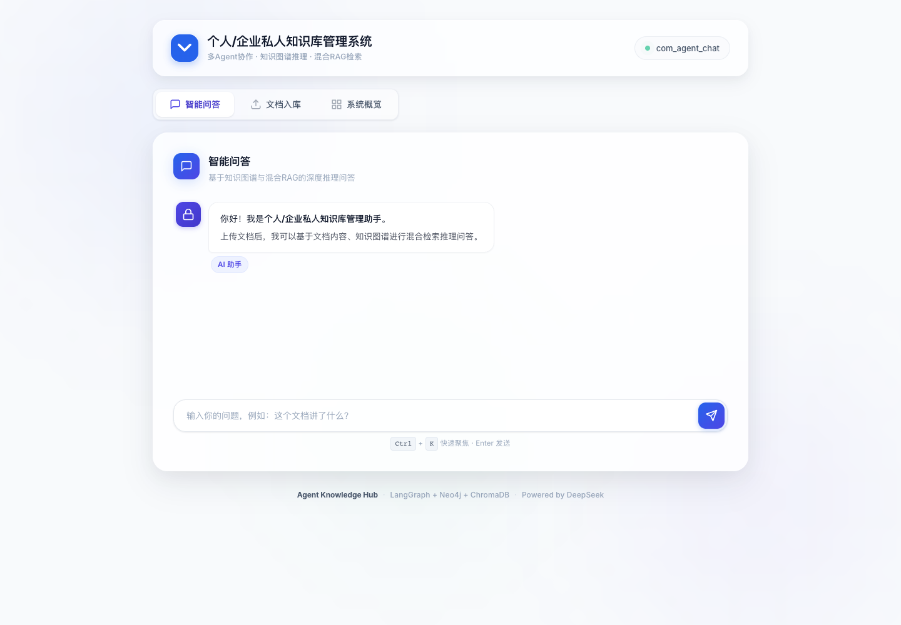
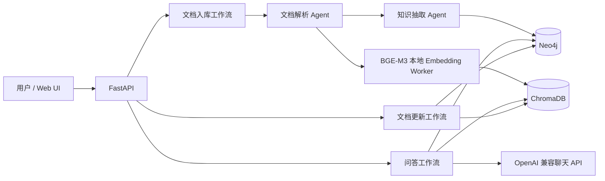

# com_agent_chat

基于 LangGraph 的多 Agent 私有知识库。项目提供文档解析、知识图谱、语义检索和 RAG 问答；Python API 与 Web 前端在本机运行，Neo4j、ChromaDB、Kafka 和 Zookeeper 由 Docker Compose 提供。



## 目录

- [功能](#功能)
- [工作流程](#工作流程)
- [环境要求](#环境要求)
- [快速开始](#快速开始)
- [地址与健康检查](#地址与健康检查)
- [常用运维命令](#常用运维命令)
- [API 概览](#api-概览)
- [项目结构](#项目结构)
- [故障排查](#故障排查)
- [参考](#参考)

## 功能

- **文档入库**：解析 PDF、图片、TXT、Markdown、HTML、DOCX、PPTX、CSV 和 Excel 文件。
- **知识抽取**：使用 OpenAI 兼容的聊天 API 抽取实体、关系和事件，并写入 Neo4j。
- **语义检索**：使用 DeepSeek 配置时，在本地 CPU 上运行 `BAAI/bge-m3`，生成 1024 维向量并保存到 ChromaDB。
- **智能问答**：结合向量检索与知识图谱检索，生成包含来源的答案。
- **管理与更新**：查询知识库统计，并通过 API 触发文档更新流程。

## 工作流程



Kafka 和 Zookeeper 随 Compose 启动。CDC 消费方法在代码中提供，但 `start-local.sh` 不会自动启动消费者；当前文档更新入口是 `/api/admin/update`。

## 环境要求

- macOS 或 Linux
- Conda 与 Python 3.12
- Docker Desktop 或 Docker Engine，以及 Docker Compose v2
- 至少 3 GB 可用磁盘空间，用于 BGE-M3 dense 模型文件
- OpenAI 兼容的聊天 API 密钥；DeepSeek 可用作聊天模型服务
- 图片 OCR 需要系统级 Tesseract 和对应语言包

## 快速开始

### 1. 克隆项目并安装 Python 依赖

```bash
git clone https://github.com/Huangbingshuai/com_agent_chat.git
cd com_agent_chat

conda create -n com-agent-chat python=3.12 -y
conda activate com-agent-chat
python -m pip install -r python/requirements.txt
```

已有 `com-agent-chat` 环境时，激活该环境并安装依赖即可。

### 2. 下载 BGE-M3

模型权重不存放在 Git 仓库中。以下命令从魔搭社区下载 dense 检索所需文件，并跳过 ONNX、图片、sparse 和 ColBERT 文件：

```bash
python -m pip install modelscope
python - <<'PY'
from modelscope import snapshot_download

snapshot_download(
    model_id="BAAI/bge-m3",
    local_dir="./models/bge-m3",
    ignore_file_pattern=[
        "onnx/*",
        "imgs/*",
        "colbert_linear.pt",
        "sparse_linear.pt",
        "long.jpg",
    ],
)
PY
```

模型来源：[魔搭社区 BAAI/bge-m3](https://modelscope.cn/models/BAAI/bge-m3)。下载目录默认为 `models/bge-m3`。模型路径相对于仓库根目录，可通过 `LOCAL_EMBEDDING_MODEL_PATH` 修改。当前代码在 `OPENAI_BASE_URL` 包含 `deepseek` 时使用本地 BGE-M3；其他 API 地址会使用 `EMBEDDING_MODEL` 配置的 OpenAI 兼容 Embedding API。

### 3. 配置聊天 API

```bash
cp python/.env.example python/.env
```

编辑 `python/.env`，填入自己的 API Key 和聊天模型配置。DeepSeek 示例：

```dotenv
OPENAI_API_KEY=你的DeepSeek_API_Key
OPENAI_BASE_URL=https://api.deepseek.com
OPENAI_MODEL=deepseek-flash
LOCAL_EMBEDDING_MODEL_PATH=models/bge-m3
VECTOR_STORE_TYPE=chroma
CHROMA_HOST=localhost
CHROMA_PORT=8000
```

`.env` 包含密钥，已被 Git 忽略。DeepSeek Key 用于聊天和知识抽取；向量由本地 BGE-M3 生成。

| 环境变量 | 必需 | 用途与默认值 |
| --- | --- | --- |
| `OPENAI_API_KEY` | LLM 功能必需 | 聊天及知识抽取 API Key；只在本机 `.env` 中填写 |
| `OPENAI_BASE_URL` | 否 | API 地址；默认 `https://api.openai.com/v1`，DeepSeek 使用 `https://api.deepseek.com` |
| `OPENAI_MODEL` | 否 | 聊天模型；默认 `gpt-4o`，需与服务商支持的模型名一致 |
| `LOCAL_EMBEDDING_MODEL_PATH` | 否 | 本地模型目录；默认 `models/bge-m3` |
| `EMBEDDING_MODEL` | 否 | 非 DeepSeek 地址使用的远程 Embedding 模型 |
| `DISABLE_LOCAL_EMBEDDINGS` | 否 | 默认 `0`；设为 `1` 会关闭本地向量生成 |
| `VECTOR_STORE_TYPE` | 否 | 默认 `chroma`；`pgvector` 需要另行提供 PostgreSQL 服务 |
| `CHROMA_HOST` / `CHROMA_PORT` | 否 | ChromaDB 地址；默认 `localhost:8000` |

### 4. 启动前后端和依赖服务

```bash
./start-local.sh
```

脚本按 `com-agent-chat` Compose 项目名启动 Neo4j、ChromaDB、Zookeeper 和 Kafka，等待依赖就绪后，在 Conda 环境中启动本机 API 与 Web 前端。API 监听 `127.0.0.1:8081`。若端口已被占用，脚本会显示占用进程并退出，不会自动结束该进程。

## 地址与健康检查

| 服务 | 地址 |
| --- | --- |
| Web 前端 | <http://127.0.0.1:8081> |
| API 文档 | <http://127.0.0.1:8081/docs> |
| API 健康检查 | <http://127.0.0.1:8081/api/health> |
| Neo4j Browser | <http://127.0.0.1:7474> |
| ChromaDB | <http://127.0.0.1:8000> |

验证 API 与 ChromaDB：

```bash
curl -fsS http://127.0.0.1:8081/api/health
curl -fsS http://127.0.0.1:8081/api/admin/stats
curl -fsS http://127.0.0.1:8000/api/v2/heartbeat
```

API 健康检查成功时返回 `{"status":"ok","service":"com_agent_chat"}`。

Neo4j Compose 默认开发凭据为 `neo4j/password`，不要将此默认凭据用于对外暴露的部署。

## 常用运维命令

在另一个终端进入仓库根目录：

```bash
# 查看本项目容器
docker compose --project-name com-agent-chat -f docker-compose.yml ps

# 跟踪依赖容器日志
docker compose --project-name com-agent-chat -f docker-compose.yml logs -f neo4j chromadb kafka zookeeper

# 停止依赖容器并保留命名卷数据
docker compose --project-name com-agent-chat -f docker-compose.yml stop
```

API 日志输出在运行 `./start-local.sh` 的终端。按 `Ctrl+C` 停止 API；Compose 依赖容器需要单独停止。避免使用 `docker compose down -v` 日常关停，因为 `-v` 会删除 Neo4j 和 ChromaDB 的持久化数据卷。

## API 概览

| 方法 | 路径 | 用途 |
| --- | --- | --- |
| `GET` | `/api/health` | API 健康状态 |
| `POST` | `/api/ingest/upload` | 上传单个文件，表单字段 `file` |
| `POST` | `/api/ingest/batch` | 批量上传，表单字段 `files` |
| `POST` | `/api/qa/ask` | 提问，JSON 格式 `{ "question": "你的问题" }` |
| `GET` | `/api/admin/stats` | 查询向量和图谱统计 |
| `POST` | `/api/admin/update` | 触发文档更新工作流 |

完整的参数和响应格式见 [Swagger 文档](http://127.0.0.1:8081/docs)。向量保存在 `knowledge_chunks_bge_m3` collection 中，旧 collection 会保留。

提交一个问答请求：

```bash
curl -X POST http://127.0.0.1:8081/api/qa/ask \
  -H 'Content-Type: application/json' \
  -d '{"question":"这个知识库里有哪些主题？"}'
```

## 项目结构

```text
.
├── README.md
├── docker-compose.yml
├── start-local.sh
├── models/bge-m3/             # 本地模型，不提交到 Git
└── python/
    ├── agents/                # 文档解析、知识抽取、问答、知识更新
    ├── api/main.py            # FastAPI 与前端静态文件
    ├── config/settings.py     # 环境配置
    ├── orchestrator/graph.py  # LangGraph 工作流
    ├── services/              # 向量库、知识图谱、Embedding Worker
    ├── static/                # Web 前端
    ├── requirements.txt
    └── .env.example
```

## 故障排查

### 端口已占用

检查端口占用后再决定是否停止对应进程。依赖服务端口包括 `7474`、`7687`、`8000` 和 `9092`；API 端口为 `8081`。

```bash
lsof -nP -iTCP:8081 -sTCP:LISTEN
```

### Embedding Worker 无法加载模型

确认 `models/bge-m3` 中有 BGE-M3 权重及 tokenizer 文件，并检查 `LOCAL_EMBEDDING_MODEL_PATH`。worker 在本机 CPU 上运行模型。

### 向量维数冲突

BGE-M3 使用 `knowledge_chunks_bge_m3` collection，与历史 collection 分开保存。不要为解决维数问题而删除 Docker 数据卷；删除卷会清空数据库数据。

## 参考

- [BAAI/bge-m3 模型卡（魔搭社区）](https://modelscope.cn/models/BAAI/bge-m3)
- [BGE-M3 / FlagEmbedding](https://github.com/FlagOpen/FlagEmbedding)
