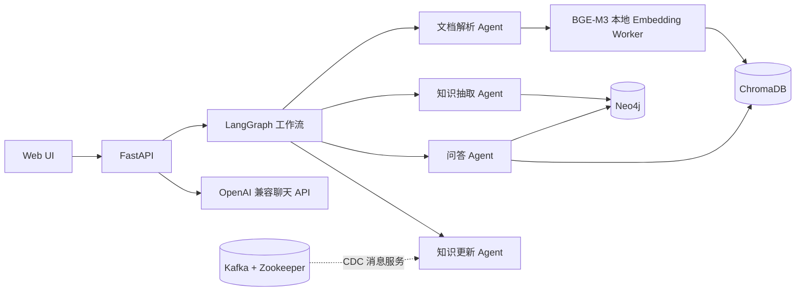

# com_agent_chat

基于 LangGraph 的多 Agent 私有知识库项目，提供文档解析与入库、知识图谱构建、混合检索问答和文档增量更新接口。当前推荐以 Conda 在本机运行 Python API 与 Web 前端，以 Docker Compose 隔离启动 Neo4j、ChromaDB、Zookeeper 和 Kafka。

## 功能

| 模块 | 作用 |
| --- | --- |
| 文档解析 | 解析 PDF、图片、TXT、Markdown、HTML、DOCX、PPTX、CSV 和 Excel 文件，并切分文本块 |
| 知识抽取 | 调用 OpenAI 兼容的聊天模型抽取实体、关系和事件，写入 Neo4j |
| 语义检索 | 使用本地 `BAAI/bge-m3` 生成 1024 维向量，存入 ChromaDB |
| 智能问答 | 查询改写后并行执行向量和图谱检索，生成带来源的答案 |
| 管理与更新 | 查看向量、实体、关系统计；提供文档更新 API |

## 架构



本机运行时，Compose 项目名固定为 `com-agent-chat`，因此容器、网络和命名卷使用该项目的 Compose 命名空间；API 和前端由 Conda 环境中的本机进程提供。Embedding 模型从 `models/bge-m3` 本地加载，不需要 Embedding API。

## 环境要求

- macOS 或 Linux；Conda（推荐 Python 3.12）
- Docker Desktop 或 Docker Engine，支持 Docker Compose v2
- 至少约 3 GB 可用磁盘空间用于 BGE-M3 dense 模型文件
- OpenAI 兼容聊天 API 的 API Key；DeepSeek 可作为聊天模型服务
- 如需图片 OCR，请安装系统级 Tesseract，并配置所需语言包

## 快速开始

以下命令在项目的 `code` 目录执行。

### 1. 创建 Conda 环境并安装依赖

```bash
cd /path/to/com_agent_chat/code
conda create -n com-agent-chat python=3.12 -y
conda activate com-agent-chat
python -m pip install -r python/requirements.txt
```

如果已经创建过 `com-agent-chat` 环境，直接激活并安装依赖即可。

### 2. 下载本地 BGE-M3

模型权重不会提交到 Git 仓库。首次下载前安装 ModelScope SDK；下面的过滤项排除 ONNX、图片和 sparse/ColBERT 权重，只保留当前 dense 向量服务所需文件。

```bash
python -m pip install modelscope
python - <<'PY'
from modelscope import snapshot_download

snapshot_download(
    model_id="BAAI/bge-m3",
    local_dir="./models/bge-m3",
    ignore_file_pattern=[
        "onnx/*",
        "imgs/*",
        "colbert_linear.pt",
        "sparse_linear.pt",
        "long.jpg",
    ],
)
PY
```

模型来源：[魔搭社区 BAAI/bge-m3](https://modelscope.cn/models/BAAI/bge-m3)。模型文件默认放在 `code/models/bge-m3`，也可通过 `LOCAL_EMBEDDING_MODEL_PATH` 修改相对 `code` 目录的路径。首次加载会在本地 CPU 上初始化模型，耗时取决于设备。

### 3. 配置聊天模型

```bash
cp python/.env.example python/.env
```

编辑 `python/.env`，至少设置聊天 API Key、兼容 API 地址和聊天模型。DeepSeek 示例：

```dotenv
OPENAI_API_KEY=填入你自己的DeepSeek_API_Key
OPENAI_BASE_URL=https://api.deepseek.com
OPENAI_MODEL=deepseek-flash
LOCAL_EMBEDDING_MODEL_PATH=models/bge-m3
VECTOR_STORE_TYPE=chroma
CHROMA_HOST=localhost
CHROMA_PORT=8000
```

`.env` 包含密钥，不要提交到仓库。Dense embedding 使用本地 BGE-M3；DeepSeek Key 只用于聊天和知识抽取等 LLM 调用。

### 4. 一键启动

```bash
./start-local.sh
```

脚本会先以 `com-agent-chat` 项目名启动 Neo4j、ChromaDB、Zookeeper 和 Kafka，等待依赖就绪，再通过 `conda run -n com-agent-chat` 启动本地 API 和前端。API 端口为 `8081`；如果端口已占用，脚本会停止并显示占用进程，不会自动结束它。

## 访问地址

| 服务 | 地址 |
| --- | --- |
| Web 前端 | <http://127.0.0.1:8081> |
| API 健康检查 | <http://127.0.0.1:8081/api/health> |
| Swagger 文档 | <http://127.0.0.1:8081/docs> |
| Neo4j Browser | <http://127.0.0.1:7474> |
| ChromaDB | <http://127.0.0.1:8000> |

Neo4j Compose 默认开发凭据为 `neo4j/password`。请勿将默认凭据用于对外暴露的部署。

## 常用命令

在另一个终端中进入 `code` 目录：

```bash
# 查看项目容器状态
docker compose --project-name com-agent-chat -f docker-compose.yml ps

# 查看指定容器日志
docker compose --project-name com-agent-chat -f docker-compose.yml logs -f neo4j chromadb kafka zookeeper

# 停止项目依赖容器，保留命名卷中的数据
docker compose --project-name com-agent-chat -f docker-compose.yml stop
```

API 日志直接查看启动 `./start-local.sh` 的终端。按 `Ctrl+C` 停止本机 API；容器仍保持运行，可用上面的 `stop` 命令停止依赖。

不要用 `docker compose down -v` 做日常停止操作：`-v` 会删除项目命名卷中的 Neo4j、ChromaDB 等持久化数据。

## 健康验证

```bash
curl -fsS http://127.0.0.1:8081/api/health
curl -fsS http://127.0.0.1:8081/api/admin/stats
curl -fsS http://127.0.0.1:8000/api/v2/heartbeat
```

健康接口应返回 `status: ok`；统计接口应显示 `knowledge_chunks_bge_m3` collection。上传文档后，向量数会增加。

## API

| 方法 | 路径 | 说明 |
| --- | --- | --- |
| `GET` | `/api/health` | API 健康状态 |
| `POST` | `/api/ingest/upload` | 上传单个文档，表单字段名为 `file` |
| `POST` | `/api/ingest/batch` | 批量上传，表单字段名为 `files` |
| `POST` | `/api/qa/ask` | JSON `{ "question": "你的问题" }` |
| `GET` | `/api/admin/stats` | 查看向量与知识图谱统计 |
| `POST` | `/api/admin/update` | 触发指定文档的更新流程 |

完整请求和响应格式可在 `/docs` 查看。

## 目录结构

```text
code/
├── README.md
├── docker-compose.yml
├── start-local.sh
├── models/bge-m3/            # 本地下载，Git 忽略
└── python/
    ├── agents/               # 文档解析、知识抽取、问答、知识更新 Agent
    ├── api/main.py           # FastAPI 与前端静态文件
    ├── config/settings.py    # 环境变量配置
    ├── orchestrator/graph.py # LangGraph 工作流
    ├── services/             # Neo4j、ChromaDB、Embedding Worker 等服务
    ├── static/               # Web UI
    ├── requirements.txt
    └── .env.example
```

## 常见问题

### 启动时提示端口已占用

检查占用情况后，确认对应进程再自行停止；启动脚本不会擅自杀进程。除 API 的 `8081` 外，依赖还使用 `7474`、`7687`、`8000` 和 `9092`。

```bash
lsof -nP -iTCP:8081 -sTCP:LISTEN
```

### Embedding Worker 无法加载模型

确认 `code/models/bge-m3` 中包含 BGE-M3 的模型权重和 tokenizer 文件，并检查 `LOCAL_EMBEDDING_MODEL_PATH`。模型加载发生在本机；下载完成后，运行时使用本地文件。

### 检索到旧向量或维数冲突

本项目使用 `knowledge_chunks_bge_m3` collection，避免与历史 collection 的向量维数冲突。切勿在未备份的情况下删除 Docker 命名卷。

## 参考

- [BAAI/bge-m3 模型卡（魔搭社区）](https://modelscope.cn/models/BAAI/bge-m3)
- [BGE-M3 / FlagEmbedding](https://github.com/FlagOpen/FlagEmbedding)
